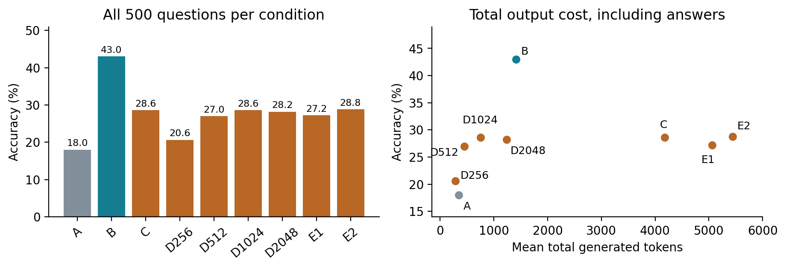
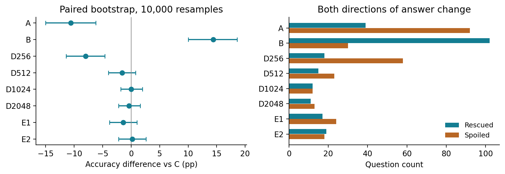

# Budget Forcing on a 1.5B Model: A Resource-Constrained Study

Faisal Imran | Muhammad Ibrahim | Hamza Saeed

Research project report | 17 November 2026 | Completed single-run study

## Abstract

We study s1-style supervised adaptation and inference-time budget forcing with Qwen2.5-1.5B-Instruct under limited local resources. One LoRA run trains on 896 complete original s1K examples using an 8 GB Apple M1; 100 development examples remain held out. A separately frozen FP16/vLLM evaluation reconstructed from the trained four-bit base produces all 4,500 planned MATH-500 outputs. The reasoning-prompted base scores 43.0%, compared with 28.6% for adapted bounded natural stopping. A 1,024-token reasoning cap also scores 28.6% while using 82.1% fewer generated tokens. Up to two Wait continuations score 28.8%, with a paired difference of +0.2 percentage points and a 95% interval of [-2.2, 2.6], at 30.2% higher token cost. We find no clear continuation benefit in this run. Frequent safety-cap hits, a shared injected answer label, and pre-intervention trajectory divergence constrain causal interpretation. The result is a documented small-model adaptation, not a reproduction of the original 32B model's performance.

## 1. Introduction

Longer reasoning is useful only if its accuracy gain justifies its cost. The original s1 work combines a curated 1,000-example dataset with budget forcing, including shorter reasoning caps and Wait-based continuation [1]. Our question is whether the same broad idea remains useful with a 1.5B model and hardware that cannot support the original training setup.

We contribute a complete constrained implementation, a source-traced Mac-to-CUDA export, and a nine-condition evaluation with per-question provenance. The important outcome is mixed: held-out teacher-target loss improves after training, yet the adapted evaluation policy does not beat the reasoning-prompted base. Shorter caps often save substantial output cost; additional continuation has uncertain benefit. We retain all outcomes, including extraction failures and spoiled answers.

## 2. Related work and scope

Chain-of-thought prompting studies intermediate reasoning as part of generation [2]; it motivates a strong reasoning-prompted base control rather than comparison only with direct answers. LoRA freezes base weights and learns low-rank updates [3]. We combine that method with affine four-bit MLX weights and FP32 activations, rather than claiming the original s1 full-training procedure. vLLM provides an inference serving system based on PagedAttention [4]. We use it to make evaluation practical, and keep its FP16 results separate from the original Mac run. Qwen2.5 [5] supplies the pretrained model family; MATH [6] supplies the underlying competition-mathematics benchmark lineage.

Original s1 contributions are dataset curation and budget forcing [1]. Our contribution is a measured small-model adaptation and failure analysis. We do not recreate teacher data, reproduce the 32B scores, or claim new scaling laws. The public s1 repository now includes later variants; this project pins the original s1K rather than silently using s1K-1.1.

<!-- pagebreak -->

## 3. Data, training and inference policy

### 3.1 Data and accepted training run

The seeded raw split is 900 training / 100 development examples (seed 42). Four conservatively identified benchmark overlaps are excluded from training, leaving 896 training and 100 development examples. One normalized duplicate pair remains wholly in training and is disclosed. Exact-match and normalized overlap checks do not rule out semantic contamination or pretraining exposure. Eligible sequences span 712-9,109 tokens and are kept complete under a 9,216-token training ceiling; no examples are dropped or truncated for length.

The formatter supervises the teacher thinking trajectory and answer while masking the user prompt and padding. All 28 attention layers receive q/k/v/o LoRA updates: rank 16, alpha 32, scale 2, dropout 0.05, 4,358,144 trainable parameters. AdamW uses learning rate 5e-5, micro-batch 1, accumulation 16 and one epoch: 56 updates over all 896 examples. The accepted MLX path uses affine Q4 weights, group size 64, and FP32 activations/adapters after numerical and memory failures on earlier PyTorch paths. Fresh-process adapter tensor and generation reload checks pass.

The user accepted this single run to limit compute. No second trial or fresh 996-example final retraining was performed; all 100 development examples remain held out. On identical 555,371 development target tokens, teacher-target NLL decreases from 0.563623 to 0.479717 (14.9% relative). This measures imitation of teacher tokens, not benchmark answer accuracy.

### 3.2 Protocol and development-only readout repair

A uses a direct-answer base prompt; B asks the base to reason. C uses the adapted structured reasoning/answer format. D256/D512/D1024/D2048 cap its reasoning phase. E1/E2 permit up to one/two Wait injections when reasoning stops. C and E share an 8,192-token reasoning ceiling, a separate 1,536-token answer allowance and a 12,288-token absolute ceiling including control tokens. A/B have a 9,728-token unstructured allowance. Greedy decoding and a 900-second timeout are fixed before testing.

The first 45 development outputs exposed failed structured answer extraction. Fifteen same-adapter development probes motivated a common injected `Final Answer: ` label after the training-format answer header. All C/D/E conditions use the same label. The raw generated body and injected label have separate provenance; an empty body remains an extraction failure. The repeated 45-output gate yields 40 extractable outputs. This is a development-only behavior check, not benchmark tuning or an accuracy score.

Stop tokens are logged and charged to generated-token budgets even when removed before continuation. Injected Wait and answer-transition tokens count toward absolute context use, separately from generated output. The final test shows EOS-based reasoning stops and no intercepted learned role-marker stops. Thus this study evaluates the declared adapted policy, not established reproduction of the original learned reasoning delimiter.

### 3.3 Separate GPU evaluation and grading

For RunPod, the frozen Q4 codes, scales and biases are reconstructed as scale * code + bias and rounded to FP16. The original dense pretrained checkpoint is not substituted. All 224 LoRA matrices are transposed exactly into PEFT format; source-adapter fingerprints and prompt token IDs are verified. Maximum base FP16 rounding error is 0.000244140625. No optimization occurs on the GPU. This export changes numerical execution, so FP16/CUDA is a separate frozen experiment.

A single RTX 4090 runs eight concurrent state machines through one vLLM engine. Answer extraction and symbolic/numeric equivalence use frozen math-verify 0.9.0 and SymPy 1.14.0. An absent extracted answer is marked incorrect; malformed and unextracted outputs remain in the 500-question denominator. Raw prompts, segments, grades and hashes are saved. Grader equivalence and extraction remain imperfect; all test gold answers were checked against the pinned source.

<!-- pagebreak -->

## 4. Results and uncertainty

| ID | Condition | Correct / 500 | Accuracy | Mean reasoning | Mean total | Mean seconds | Extraction failures |
|---|---|---:|---:|---:|---:|---:|---:|
| A | Base direct | 90 | 18.0% | N/A | 344.9 | 2.41 | 21 |
| B | Base reasoning | 215 | 43.0% | N/A | 1413.9 | 9.63 | 52 |
| C | Adapted natural* | 143 | 28.6% | 4139.4 | 4178.5 | 28.58 | 6 |
| D256 | Cap 256 | 103 | 20.6% | 243.8 | 283.0 | 2.06 | 5 |
| D512 | Cap 512 | 135 | 27.0% | 434.3 | 448.2 | 3.16 | 7 |
| D1024 | Cap 1024 | 143 | 28.6% | 721.6 | 749.1 | 5.17 | 5 |
| D2048 | Cap 2048 | 141 | 28.2% | 1217.5 | 1236.5 | 8.44 | 7 |
| E1 | Wait up to 1 | 136 | 27.2% | 5026.4 | 5059.5 | 34.60 | 9 |
| E2 | Wait up to 2 | 144 | 28.8% | 5395.6 | 5441.0 | 37.23 | 7 |

Table 1. Complete MATH-500 matrix. Each condition has 500 model outputs and 500 resolved grades. Reasoning tokens are unavailable for unstructured A/B. Total tokens include answers and emitted stop tokens but exclude injected controls. *C has a finite safety ceiling. Seconds are shared-scheduling request latency, not isolated single-request latency.

| vs C | Difference (pp) | 95% paired interval (pp) | Rescued | Spoiled |
|---|---:|---:|---:|---:|
| A | -10.6 | [-15.0, -6.2] | 39 | 92 |
| B | +14.4 | [10.0, 18.6] | 102 | 30 |
| D256 | -8.0 | [-11.4, -4.6] | 18 | 58 |
| D512 | -1.6 | [-4.0, 0.8] | 15 | 23 |
| D1024 | +0.0 | [-1.8, 2.0] | 12 | 12 |
| D2048 | -0.4 | [-2.2, 1.6] | 11 | 13 |
| E1 | -1.4 | [-3.8, 1.0] | 17 | 24 |
| E2 | +0.2 | [-2.2, 2.6] | 19 | 18 |

Table 2. Paired differences relative to C, in percentage points. Intervals use 10,000 paired question-ID bootstrap samples with replacement, seed 42, percentile 95% coverage. All 500 pairs enter each comparison. Intervals are descriptive and unadjusted for multiple comparisons; no equivalence test was prespecified.

B is the strongest observed policy (215/500), ahead of C (143/500). This comparison changes both prompt/readout and adapter, so it cannot identify the causal effect of fine-tuning alone. D1024 matches C's observed accuracy while reducing mean total output from 4,178.5 to 749.1 tokens. Its interval [-1.8, 2.0] does not establish statistical equivalence. The cap was predeclared; this post-hoc efficiency observation is not permission to retune on the test set.

E1 rescues 17 answers but spoils 24, for -1.4 pp [-3.8, 1.0]. E2 rescues 19 and spoils 18, for +0.2 pp [-2.2, 2.6]. The benchmark gives no clear evidence that continuation improves the adapted model. E2 uses 5,441.0 mean tokens versus C's 4,178.5. Extraction succeeds on 4,381/4,500 outputs; the 119 failures are counted as incorrect. There are zero infrastructure failures and zero timeouts, and every output succeeds on its first recorded attempt.

<!-- pagebreak -->

## 5. Budget behavior and failure analysis

C hits its reasoning/safety ceiling on 238/500 outputs (47.6%); E1 hits it on 286 (57.2%) and E2 on 303 (60.6%). A bounded natural baseline is therefore often censored by its safety ceiling. D256/D512/D1024/D2048 hit their intended reasoning caps on 434/318/256/242 outputs. Answer caps occur on 10/2/6/3 outputs respectively, versus 10 for C, 7 for E1 and 12 for E2. Cap categories can overlap and are not infrastructure errors.

E1 actually injects Wait on 264 questions. E2 injects two Waits on 208, one on 54, and none on 238. Extra opportunities do not imply extra continuation for every question. The final trace audit also finds identical first reasoning segments versus C for only 395/500 E1 and 393/500 E2 outputs. Greedy concurrent FP16 execution is not a token-identical counterfactual control; the precise source of divergence was not isolated. Some answer changes precede the intended intervention, limiting attribution to Wait itself.

Figure 1. Full-denominator accuracy and measured output cost. The strongest observed policy is base reasoning B. C/D/E do not establish monotonic accuracy improvement with more reasoning tokens.

<!-- pagebreak -->

Figure 2. Unadjusted paired 95% intervals and both directions of answer change. A/B vs C include prompt and adapter changes; D/E are declared policy comparisons with pre-intervention divergence caveats.

### 5.1 Qualitative cases

The frozen selection rule chooses the lexicographically first question ID in each rescued, spoiled, unchanged-wrong and unchanged-right category for every D/E policy: 24 cases, all retained in the appendix file. At `test/algebra/170.json`, C repeatedly counts overlapping integer-range endpoints and answers 21; D256 answers the gold 11. At `test/algebra/1031.json`, C answers the correct 5.5, while D256 answers 10. These traces illustrate both repetition drift and loss of a correct answer under a changed policy.

At `test/algebra/1960.json`, D1024 changes C's incorrect 3 to the correct 9 despite both initial reasoning lengths being below the cap. The first trajectories already differ, so the example does not isolate truncation as the cause. At `test/algebra/1004.json`, several policies retain an equation rather than the requested resolved value; explicit answer extraction alone is not correctness. These examples are descriptive, and intermediate reasoning is not treated as a faithful account of internal computation.

## 6. Conclusion

A complete small-model experiment is feasible with local adapter training and separately validated GPU inference. In this single accepted run, s1-style adaptation does not yield a policy that beats the reasoning-prompted base. A 1,024-token cap preserves observed adapted accuracy at much lower output cost, while extra Wait continuation has uncertain benefit and substantially higher cost. The central result is an efficiency observation and a limit on transfer to this setup, not a refutation of original s1 or proof that more compute never helps. Stronger causal claims would require matched prompt controls, controlled numerical execution and additional training seeds; those experiments were not run.

<!-- pagebreak -->

## Limitations

Only one training seed, one accepted recipe and one 500-question benchmark were evaluated. The original plan's second learning-rate trial and fresh all-eligible-data retraining were deliberately skipped. We cannot infer variation across training seeds, generality across domains, or performance of an optimally trained 1.5B model. AIME24 and the optional combined cap-plus-Wait condition were not run.

Model size, LoRA training, four-bit base weights, FP32 training activations, FP16 reconstructed evaluation and the answer-label repair all depart from original s1. NLL improvement does not isolate mathematical reasoning ability. A/B and C/D/E use different output protocols, so the observed B-C difference is a policy comparison, not a controlled adapter ablation. The answer label is supplied by the system, not learned evidence of spontaneous answer formatting.

Frequent safety stops censor natural reasoning, and EOS continuation is not established learned-delimiter continuation. Greedy batched trajectories can diverge before intervention. Bootstrap intervals describe question sampling conditional on this run; they do not include training, numerical, dataset contamination or grader uncertainty. We did not establish equivalence, a causal benefit from Wait, or controlled hardware-only speed ratios.

## Ethical considerations and release status

The study uses public pretrained artifacts and teacher-generated data; it creates no new human-subject dataset. Mathematical outputs can be wrong despite plausible reasoning. We publish aggregate results and source code, while raw benchmark text, traces and weights stay in a local handoff. Inspected Qwen and s1K metadata declare Apache-2.0; inspected MATH-500 metadata does not declare a license. No project-wide license grant or benchmark redistribution right is invented. Check upstream terms before further redistribution. AI assistance was used for implementation and report preparation; the named authors remain responsible for verification and any eventual submission.

## References

[1] Muennighoff et al. 2025. s1: Simple test-time scaling. Original version, arXiv:2501.19393v1. https://arxiv.org/abs/2501.19393v1

[2] Wei et al. 2022. Chain-of-Thought Prompting Elicits Reasoning in Large Language Models. arXiv:2201.11903. https://arxiv.org/abs/2201.11903

[3] Hu et al. 2021. LoRA: Low-Rank Adaptation of Large Language Models. arXiv:2106.09685. https://arxiv.org/abs/2106.09685

[4] Kwon et al. 2023. Efficient Memory Management for Large Language Model Serving with PagedAttention. SOSP 2023, arXiv:2309.06180. https://arxiv.org/abs/2309.06180

[5] Qwen et al. 2025. Qwen2.5 Technical Report. arXiv:2412.15115. https://arxiv.org/abs/2412.15115

[6] Hendrycks et al. 2021. Measuring Mathematical Problem Solving With the MATH Dataset. arXiv:2103.03874. https://arxiv.org/abs/2103.03874

[7] Hugging Face. Math-Verify, version 0.9.0. https://github.com/huggingface/Math-Verify

<!-- pagebreak -->

## Appendix A. Reproducibility and detailed costs

| ID | Median reasoning | Median total | Median seconds | Reason cap | Safety cap | Answer cap |
|---|---:|---:|---:|---:|---:|---:|
| A | N/A | 10 | 0.15 | 0 | 12 | 0 |
| B | N/A | 464.5 | 3.17 | 0 | 50 | 0 |
| C | 1016.5 | 1063 | 7.14 | 238 | 238 | 10 |
| D256 | 256 | 259 | 1.89 | 434 | 0 | 10 |
| D512 | 512 | 514 | 3.48 | 318 | 0 | 2 |
| D1024 | 1024 | 1026 | 6.55 | 256 | 0 | 6 |
| D2048 | 1155.5 | 1187 | 7.67 | 242 | 0 | 3 |
| E1 | 8191 | 8194 | 53.94 | 286 | 286 | 7 |
| E2 | 8191 | 8194 | 54.22 | 303 | 303 | 12 |

Table A1. Medians and event counts over 500 questions each. A/B have no separate structured reasoning phase. Reasoning caps in D are intentional, while C/E reasoning cap events are their shared safety limit. Events can overlap; totals should not be summed across categories.

The source code is at https://github.com/faisalAI27/Qwen2.5-1.5B-finetune . The GPU launcher/backend is pinned to commit 1cae805a2a29b7ba769838380f2fd71f058fa824, with source asset code at e4096450228f194e6f39963dbe8bc4dd8be19be8. All finalizer/report changes are downstream documentation and diagnostics; the frozen experiment code remains unchanged.

Model revision: 989aa7980e4cf806f80c7fef2b1adb7bc71aa306. Original s1K revision: 278d72baaa2b887a7e76a70a0ae254a5a45536e4. MATH-500 revision: 6e4ed1a2a79af7d8630a6b768ec859cb5af4d3be. The exact training recipe, prompt templates, grading policy and both distinct evaluation freezes are retained in the local handoff. See docs/reproducibility.md for commands and docs/handoff.json for file checksums.

Evaluated JSONL SHA-256: e392495e76ea56b4505aa82e79c3045a1ee87f18d8edd02a34fb6179ffcd5413

Reviewed result ZIP SHA-256: f816d62d7ab56dbbc0da0327469c4b89f0775b35647e221e22d77c64d9edcaee

Source adapter tensor fingerprint: 70ef5f920cac164fa4a2c35c3b0c670efa812ea393ee9e2def92adac042d5144

The ZIP contains all 4,500 raw outputs, grades and supporting provenance, but omits reconstructible exported dense weights. The local handoff adds the original Q4 base and accepted MLX adapter so conversion can be repeated without substituting weights. CRC, safe paths, all prediction/grade hash links, source gold answers and frozen source inputs were verified. The complete analysis, including 10,000-sample paired intervals and all qualitative selections, was recomputed locally and matched the GPU export. Original analysis figures and full machine-readable tables accompany the report.

The 1,287 partial Mac outputs are preserved for provenance but are ungraded and excluded from all final scores. After archive verification the user-authorized Mac controller was stopped on 17 November 2026 at 18:09:58 Asia/Karachi. Its PAUSE marker remains in place. No additional training or full benchmark generation is needed for this report.

<!-- pagebreak -->

## Appendix B. Hardware and measured runtime

| Item | Local training host | Final evaluation host |
|---|---|---|
| Machine / device | MacBookAir10,1; Apple M1 | RunPod; NVIDIA GeForce RTX 4090 |
| CPU / accelerator | CPU 8 cores (4P + 4E); GPU 7 cores | One CUDA GPU; compute capability 8.9 |
| Memory | 8 GB unified CPU/GPU memory | 24,564 MiB reported GPU memory |
| OS / driver | macOS 26.6.2, build 25G83 | Linux; NVIDIA driver 595.91.07 |
| Python | 3.13.3, arm64 | 3.12.3 |
| Model runtime | MLX 0.32.4; MLX-LM 0.32.2 | vLLM 0.11.2; Torch 2.9.0; CUDA 12.8 |
| Numerical path | Affine Q4, group 64; FP32 activations/adapters | Dense FP16 reconstruction; FP16 LoRA |
| Context limit | 9,216 training tokens, complete examples | 16,384 tokens; no test prompt truncation |
| Scheduling | Micro-batch 1; accumulate 16 | Concurrency 8; max sequences 8 |

The accepted training run records 64,238.27 seconds (17.84 hours) in training windows, with a 66,207.96-second attempt wall time. It processes 5,066,380 input tokens and 4,926,536 supervised targets. Peak active MLX allocation is 5,750,514,820 bytes (5.36 GiB). This allocator measurement is not dedicated VRAM or total system memory; macOS and other apps share the 8 GB pool. An approximately nine-hour low-battery sleep interruption is calendar downtime, not active GPU compute. These figures do not include every failed pilot, development run or idle period.

The complete GPU test generates 9,577,261 tokens in 8,245.26 measured generation seconds (2.29 hours), or 1,161.55 aggregate generated tokens/second across concurrent requests. Wall time including engine setup is 8,266.25 seconds. This is a measured one-GPU test-generation window, not total rented GPU time or billing. No bill, energy measurement or total project cost was collected. Per-output latency includes shared scheduling and repeated segment prefills; summing it would overcount GPU wall time.

The GPU runtime uses a 0.85 memory utilization setting, prefix caching, chunked prefill and CUDA graphs. Dense base weights occupy 3,087,428,608 bytes before caches and runtime overhead. The Mac's affine quantization and the GPU's dense FP16 reconstruction differ numerically, and request scheduling differs, so this study does not report a controlled GPU-versus-Mac hardware speedup. The final 4,500 scores come exclusively from the one frozen GPU backend.

The initial local data volume was 228 GiB with approximately 12-16 GiB free during recorded early checks; free storage varied as work progressed. Storage is not accelerator memory. The project completed local training on the user's PC and used the separately authorized cloud GPU for the final full evaluation. All hardware figures above describe observed devices rather than the proposal's provisional 16-24 GB training target.
