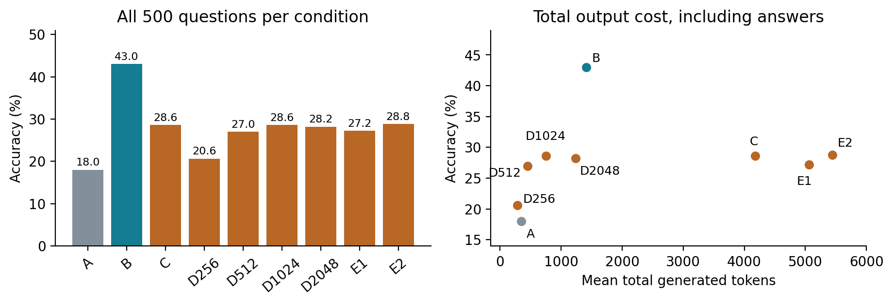
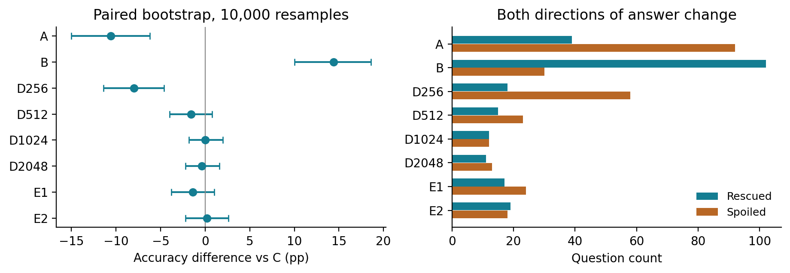

# Final MATH-500 results

The complete, separately frozen FP16/vLLM RunPod run is the final benchmark. All 4,500 predictions and grades were verified; the partial Mac run is excluded.

| ID | Condition | Correct / 500 | Accuracy | Mean reasoning | Mean total | Mean seconds | Extraction failures |
|---|---|---:|---:|---:|---:|---:|---:|
| A | Base direct | 90 | 18.0% | N/A | 344.9 | 2.41 | 21 |
| B | Base reasoning | 215 | 43.0% | N/A | 1413.9 | 9.63 | 52 |
| C | Adapted natural* | 143 | 28.6% | 4139.4 | 4178.5 | 28.58 | 6 |
| D256 | Cap 256 | 103 | 20.6% | 243.8 | 283.0 | 2.06 | 5 |
| D512 | Cap 512 | 135 | 27.0% | 434.3 | 448.2 | 3.16 | 7 |
| D1024 | Cap 1024 | 143 | 28.6% | 721.6 | 749.1 | 5.17 | 5 |
| D2048 | Cap 2048 | 141 | 28.2% | 1217.5 | 1236.5 | 8.44 | 7 |
| E1 | Wait up to 1 | 136 | 27.2% | 5026.4 | 5059.5 | 34.60 | 9 |
| E2 | Wait up to 2 | 144 | 28.8% | 5395.6 | 5441.0 | 37.23 | 7 |

*Natural stopping has an 8,192-token reasoning safety ceiling; it is not unlimited. A/B reasoning counts are unavailable because their output is unstructured. All means include the full 500-question denominator. Seconds are concurrent request latency, not isolated latency.

## Medians and cap events

| ID | Median reasoning | Median total | Median seconds | Reason cap | Safety cap | Answer cap |
|---|---:|---:|---:|---:|---:|---:|
| A | N/A | 10 | 0.15 | 0 | 12 | 0 |
| B | N/A | 464.5 | 3.17 | 0 | 50 | 0 |
| C | 1016.5 | 1063 | 7.14 | 238 | 238 | 10 |
| D256 | 256 | 259 | 1.89 | 434 | 0 | 10 |
| D512 | 512 | 514 | 3.48 | 318 | 0 | 2 |
| D1024 | 1024 | 1026 | 6.55 | 256 | 0 | 6 |
| D2048 | 1155.5 | 1187 | 7.67 | 242 | 0 | 3 |
| E1 | 8191 | 8194 | 53.94 | 286 | 286 | 7 |
| E2 | 8191 | 8194 | 54.22 | 303 | 303 | 12 |

Event categories can overlap; a reasoning cap is intentional in D conditions.

## Paired uncertainty

| vs C | Difference (pp) | 95% paired interval (pp) | Rescued | Spoiled |
|---|---:|---:|---:|---:|
| A | -10.6 | [-15.0, -6.2] | 39 | 92 |
| B | +14.4 | [10.0, 18.6] | 102 | 30 |
| D256 | -8.0 | [-11.4, -4.6] | 18 | 58 |
| D512 | -1.6 | [-4.0, 0.8] | 15 | 23 |
| D1024 | +0.0 | [-1.8, 2.0] | 12 | 12 |
| D2048 | -0.4 | [-2.2, 1.6] | 11 | 13 |
| E1 | -1.4 | [-3.8, 1.0] | 17 | 24 |
| E2 | +0.2 | [-2.2, 2.6] | 19 | 18 |

10,000 paired question-level bootstrap samples, seed 42, percentile 95% intervals; unadjusted and descriptive, with no equivalence margin. Failures remain in the 500-question denominator.

D1024 matches the observed C accuracy with 82.1% fewer total generated tokens. This is an observed efficiency result, not statistical equivalence or a new test-selected default. E2 uses 30.2% more tokens and gains one net correct answer. Base reasoning B is strongest, but B vs C changes both prompting/readout and adapter, so their gap is not a pure adapter effect.

See [the qualitative audit](error_cases.md), [the paper](paper.md), and [machine-readable results](final_results.json).
